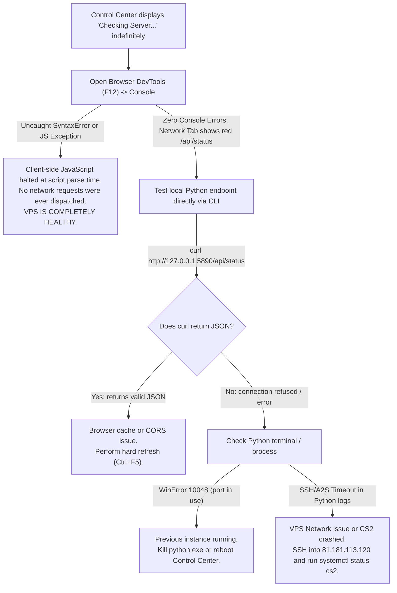

# CS2 Dedicated Server Documentation & Session Backup

## Server Details & SSH Credentials
- **Host / IP**: `81.181.113.120`
- **SSH Port**: `22`
- **Username**: `root`
- **Server User**: `csgoserver` (UID 1000)
- **CS2 Root Directory**: `/home/csgoserver/server-cs2`
- **CS2 Binary**: `/home/csgoserver/server-cs2/game/bin/linuxsteamrt64/cs2`
- **CounterStrikeSharp Directory**: `/home/csgoserver/server-cs2/game/csgo/addons/counterstrikesharp`
- **Source Code Repositories on Server**:
  - `AdminPlus` (`wlzadmin`): `/home/csgoserver/cs2-adminplus`
  - `MenuManagerCore` (`/menu` WASD menu engine): `/home/csgoserver/cs2-menumanager`
  - `WeaponPaints` (Skins, Knives, Gloves): `/home/csgoserver/cs2-weaponpaints`
- **Systemd Service (CS2 Game Server)**: `cs2.service` (`systemctl restart cs2`, `systemctl status cs2`)
- **Systemd Service (Discord Status Bot)**: `cs2-discord-bot.service` (`systemctl restart cs2-discord-bot`, `systemctl status cs2-discord-bot`)
- **Discord Bot Directory**: `/home/csgoserver/cs2-discord-bot` (Config: `/home/csgoserver/cs2-discord-bot/config.json`)

---

## What Was Fixed In This Session

### 1. Panel Scrolling Issues Resolved (`wlzadmin` / `AdminPlus`)
- **Root Cause**:
  1. `ProcessMenuInput` in `AdminPlus.InternalMenu.cs` recorded input snapshot transitions before running the debounce check. Rapid presses or presses during the grace window were swallowed, and held keys were discarded as duplicates, completely blocking scrolling down.
  2. The sliding window tried to display 5 items per view at `fontSize-m`. In CS2 Panorama's center HTML container (~140px), 5 items plus header and footer clipped out of the screen on 4:3 stretched resolutions.
- **Fix**:
  1. Implemented reliable edge-triggered button detection (`justPressed`) using bitwise operations (`PlayerButtons`).
  2. Added smooth auto-repeat scrolling when holding `W` or `S` (250ms initial delay, 90ms repeat cadence).
  3. Window size set to 4 visible items with `fontSize-s`, keeping all lines and control shortcuts (`Move`, `Select`, `Back`, `Exit`) fully visible without vertical clipping on any aspect ratio.
  4. Smooth edge-pinned scrolling offset with wraparound navigation at boundaries.

### 2. Alt Slots and Template Placeholders Removed
- **Removed Entries**:
  - `Server_Owner_Alt`
  - `Server_Owner_Alt2`
  - `EXAMPLE_STAFF_ADMIN_REPLACE_STEAMID`
  - `EXAMPLE_STAFF_MOD_REPLACE_STEAMID`
- **Preserved Existing Admins** (Strictly Preserved):
  - `Server_Owner` (SteamID: `76561199135800683`, Immunity: 100, Flags: `@css/root`, Groups: `#wlz/owner`, `#css/admin`)
  - `Fiora` (SteamID: `76561198855173662`, Immunity: 90, Groups: `#wlz/admin`)
  - `Piskeletto_pablo` (SteamID: `76561199209803186`, Immunity: 90, Groups: `#wlz/admin`)
  - `远征契约` (SteamID: `76561199489270994`, Immunity: 90, Groups: `#wlz/admin`)
  - `Andreea3` (SteamID: `76561199144991900`, Immunity: 50, Groups: `#wlz/mod`)

### 3. Visuals & Emojis Cleaned Up (`wlzadmin`)
- Stripped emojis (`✅`, `❌`, `◄`, `💡`, `•`) across all language files (`lang/en.json`, `de.json`, `fr.json`, `tr.json`, `ru.json`, `pt-BR.json`, `pl.json`).
- Removed CS2 console/chat color tags (`{green}`, `{red}`, `{yellow}`, `{default}`) from center HTML strings.
- Replaced noisy selector markers (`►[ • ... ]◄`) with a clean highlighted cursor (`> Option` in `#ffffff` with `#facc15` indicator).
- Styled the header in `#4ade80` (green) with muted index indicators (`#9ca3af`), and controls in cyan (`#38bdf8`).
- Fixed a translation format exception bug in `ShowAddAdminConfirmMenu` (`Admin.Added` parameter mismatch).

### 4. `/menu` WASD Panel Fixed & Modernized (`MenuManagerCore` & `CustomMenu`)
- **Root Cause**:
  1. `MenuManagerCore` used `player.Buttons.ToString()` comparison every tick inside `OnPluginTick()`. If holding W or S, `IsEqualButtons` returned true and ignored all held inputs. Tapping quickly caused dropped frames and stuck navigation.
  2. `MenuLinesCount` defaulted to 6. Combined with `fontSize-sm`, title, and footer, 8 lines vertically overflowed the Panorama center HUD bounds on 4:3 stretched resolutions, cutting off the bottom items and controls.
  3. Language files used clunky brackets and arrow characters (`► [MENUITEM] ◄`) which shifted text alignment and looked cluttered.
- **Fix**:
  1. Replaced string-based button checking with bitwise edge detection (`justPressed`) and smooth auto-repeat (280ms initial delay, 120ms repeat) when holding W or S.
  2. Added boundary wraparound (pressing Down on last item loops to top; pressing Up on top item loops to bottom).
  3. Updated `MenuLinesCount` from 6 to 4 in config and code, using `fontSize-s` for a compact, clean layout that never clips on 4:3 stretched or standard resolutions.
  4. Added dynamic item position indicator `(selected/total)` next to the menu title.
  5. Cleaned selection indicator to gold `> ` with white text, and indented unselected items with `&nbsp;&nbsp;` so lines never jump or shake when moving cursor.
  6. Modernized footer across `en.json`, `ru.json`, `tr.json`, and `zh-Hans.json` to `[W/S] Move  [E] Select  [R] Exit`.
  7. Built and deployed to `plugins/MenuManagerCore/MenuManagerCore.dll`, with persistent source saved in `/home/csgoserver/cs2-menumanager`.

### 5. Weapon Switching Lockup Bug Fixed (`WeaponPaints`)
- **Bug Description**:
  When choosing a skin or knife from the website or in-game command, or running `/wp`, the player was permanently unable to switch weapons (1, 2, 3 or scroll wheel). The player would be locked into the current weapon/knife and forced back to it until dying.
- **Root Cause**:
  1. In `RefreshWeapons` (lines 1961-2095 in original code) and `GiveOnItemPickup`, the plugin called `item.Value?.AddEntityIOEvent("Kill", ...)` directly on carried weapons.
  2. In CS2 Source 2, calling the engine entity I/O `"Kill"` destroys the CBasePlayerWeapon entity but does **NOT** remove the handle from `CCSPlayer_WeaponServices.m_hMyWeapons`.
  3. The plugin additionally gave dummy items (`CsItem.USPS`, `CsItem.DefaultKnifeCT`) into `m_hMyWeapons` and immediately executed `"Kill"` on them.
  4. As a result, `m_hMyWeapons` was polluted with multiple dead, dangling handles. When the player tried to switch weapons, `Weapon_Switch` failed on the invalid handles, aborted the weapon switch, and forced the player back to the active weapon. The player was trapped until death cleared the pawn.
  5. Additionally, in `OnCommandRefresh` (`/wp`), `GetPlayerData` was dispatched via `Task.Run` in the background without awaiting, calling `RefreshWeapons` before the database had even returned the new skins.
- **Fix**:
  1. Completely removed all calls to `AddEntityIOEvent("Kill")` and dummy weapon spawns.
  2. Implemented safe in-place weapon updating: loops through existing `myWeapons` and calls `GivePlayerWeaponSkin(player, weapon)` directly.
  3. For knives, `GivePlayerWeaponSkin` natively invokes Valve's Source 2 engine input `ChangeSubclass` (`weapon.AcceptInput("ChangeSubclass", null, null, itemD.ToString())`), which morphs the knife model in-place without destroying entities or corrupting inventory handles.
  4. For guns, `FallbackPaintKit`, `FallbackSeed`, `FallbackWear`, dynamic attributes, nametags, and stickers update in-place with `Utilities.SetStateChanged`.
  5. In `GiveOnItemPickup`, removed the `networkedVector.Count == 1` block that was spawning and killing dummy weapons on pickup.
  6. In `OnCommandRefresh` (`/wp`) and `OnCommandSkinRefresh`, properly queued `RefreshWeapons` onto `Server.NextFrame` after `await WeaponSync.GetPlayerData(playerInfo2)` finishes, guaranteeing the latest website/database skins load seamlessly without delaying or breaking gameplay.
  7. Built and deployed to `plugins/WeaponPaints/WeaponPaints.dll`, with persistent source saved in `/home/csgoserver/cs2-weaponpaints`.

### 6. Live Knife & Weapon Skin Application Fix (`/wp`, `/knife`, `/ws`)
- **Bug Description**:
  After using `/wp` (or choosing a knife in `/knife` or skin in `/ws`), the player's knife model changed (e.g. into Karambit), but had **no skin** (plain vanilla/unpainted). The chosen paint kit only appeared after dying and respawning in the next round.
- **Root Cause**:
  1. In Counter-Strike 2, viewmodel material shaders and texture compositing are compiled once upon weapon entity instantiation (`GiveNamedItem`) and deployment.
  2. Modifying `m_nFallbackPaintKit` or dynamic attributes on an *already-existing* in-hand weapon entity does not trigger the CS2 client engine to re-compile the skin shaders on the active viewmodel.
  3. `SubclassChange` altered the 3D mesh geometry in-place, but the client kept the default vanilla material. Only upon death and respawn did the game spawn a brand-new entity, triggering `OnGiveNamedItemPost` and rendering the skin.
- **Fix**:
  1. Implemented smart dirty-checking (`WeaponNeedsRefresh`): checks if current equipped knife definition index or fallback paint kit differs from the player's configured database/menu settings.
  2. If a knife or gun needs refreshing, cleanly detaches it from the player using CounterStrikeSharp's native engine call `pawn.RemovePlayerItem(weapon)` and deletes the entity with `weapon.Remove()` (`UTIL_Remove`).
  3. Using `RemovePlayerItem` ensures the entity handle is cleanly un-hooked from `CCSPlayer_WeaponServices.m_hMyWeapons`, preventing any dead handles or weapon-switching lockups.
  4. Scheduled a safe `0.15f` timer to re-give the clean fresh entities (`CsItem.DefaultKnifeCT`/`DefaultKnifeT` or gun classname), automatically triggering `OnGiveNamedItemPost` and applying `SubclassChange` + custom paint kit, wear, seed, and stickers before drawing.
  5. Saved and restored the player's previously active weapon slot (`slot1`, `slot2`, or `slot3`), restoring ammo counts (`Clip1` and `ReserveAmmo`), so the player immediately holds their new knife/weapon with its proper skin rendered while alive!
  6. Tested, built Release binary (`WeaponPaints.dll`), deployed to `plugins/WeaponPaints/WeaponPaints.dll`, and verified via RCON.

### 7. 24/7 Discord Live Status & Player Count Bot
- **Objective**: Host a standalone Discord bot on the VPS that displays live players and the current map 24/7 in its Discord status/activity, updates a pinned live embed message in a dedicated Discord channel every 15s, and supports a `/status` slash command.
- **Architecture & Design**:
  1. Built an ultra-lightweight, non-blocking asynchronous Python bot using `discord.py` and direct low-level UDP Valve A2S (`A2S_INFO` and `A2S_PLAYER`) protocol queries to `127.0.0.1:27015`.
  2. Runs as an isolated, standalone `systemd` service (`cs2-discord-bot.service`) independent of the CS2 game engine. This ensures the bot stays online 24/7 even during server reboots, map changes, or CS2 crashes (switching presence gracefully to `🔴 Server Offline` in DND mode).
  3. Automatically tracks and updates the live embed in `#status` (`1564746794976546999`), updating player counts, map name, IP, and a one-click Steam connect link (`https://skinz.walliez.xyz/connect/` which auto-launches Steam via `steam://connect/81.181.113.120:27015`).
  4. Features interactive Discord button components below the embed:
     - `🎮 Connect via Steam`
     - `🗡️ Skin & Knife Panel` (`https://skinz.walliez.xyz`)
     - `🎵 MVP Anthems` (`https://mvpz.walliez.xyz`)
- **Bot Configuration**:
  - Service Unit: `/etc/systemd/system/cs2-discord-bot.service` (auto-restarts on failure, runs under user `csgoserver`).
  - Directory: `/home/csgoserver/cs2-discord-bot/`
  - Config: `/home/csgoserver/cs2-discord-bot/config.json`
  - Virtualenv: `/home/csgoserver/cs2-discord-bot/venv`
  - Web Connect Landing Page: `/var/www/skinz.walliez.xyz/connect/index.html`
- **Management Commands**:
  - Check status: `systemctl status cs2-discord-bot`
  - Restart bot: `systemctl restart cs2-discord-bot`
  - View live logs: `journalctl -u cs2-discord-bot -f`

### 8. Discord Server Logging (Chat Logs & Player Join/Leave Logs)
- **Objective**: Relay all in-game chat messages and player join/leave events into dedicated Discord channels with rich embeds, Steam profile links, and player avatars.
- **Architecture**:
  1. **Chat Logs**: Handled via `Chat-Logger-GoldKingZ` (already installed and loaded). Captures public and team chat, excludes in-game commands (`!`, `.`, `/`), attaches Steam avatar, and formats a rich Discord embed with the player's name and Steam profile link.
     - Config: `/home/csgoserver/server-cs2/game/csgo/addons/counterstrikesharp/plugins/Chat-Logger-GoldKingZ/config/config.json`
     - Active Webhook: `https://discord.com/api/webhooks/1564757207411859456/mXQa3hve3KdVQcSk7lf2sPWieHjWO1vg-Skm7kCt8MItICOrdBqyNTfF092O4ibnYB4D`
  2. **Player Connect / Disconnect Logs**: Handled via enhanced `ConnectAnnounce` plugin (compiled on .NET 8).
     - Resolves player country and city via `GeoLite2-City.mmdb`.
     - Suppresses transient reconnects and map change hops so map voting/switches never spam the log channel.
     - Sends `🟢 Player Connected` and `🔴 Player Disconnected` embeds with player name, clickable Steam profile link, SteamID64, country/city, reason, and live player count (`X / 24`).
     - Config: `/home/csgoserver/server-cs2/game/csgo/addons/counterstrikesharp/configs/plugins/ConnectAnnounce/ConnectAnnounceConfig.json`
     - Active Webhook: `https://discord.com/api/webhooks/1564757451700699186/4gAqAW7JRKQrub6hoTnwNk70ea8qf-ELN7YPSAFdy6tGtE5rftUA7XGH3YXKGlCGP2OH`
     - Source repository: `/home/csgoserver/test-cannounce/`

### 9. Chat & Link Censorship Completely Removed (`ChatManager`)
- **Problem**: In-game messages containing website links, URLs, IP addresses, domains, or words with periods (e.g. `talent.walliez.xyz`, `skinz.walliez.xyz`, `gg.wp`) were being censored into asterisks (`****`). Player names with clan tags or links were also censored.
- **Root Cause**: `ChatManager` had an aggressive built-in regex filter (`AdBlock.ChatMessages`, `AdBlock.PlayerNames`, and `FilterAds`) in `Events.cs` and `Helpers.cs` that matched `(?:\d{1,3}\.){3}\d{1,3}` and `(?:http(s)?://)?[\w.-]+\.[a-zA-Z]{2,}(?:/\S*)?` and replaced them with `****`.
- **Fix Applied**:
  1. **Config Update**: Set `"PlayerNames": false`, `"ChatMessages": false` under `"AdBlock"` and cleared `"BannedWords": []` in `addons/counterstrikesharp/configs/plugins/ChatManager/ChatManager.json`.
  2. **Code Removal**: Patched `Events.cs` to eliminate the `FilterAds` / `ReplaceBannedWords` interception before chat dispatch. Patched `Helpers.cs` so `FilterAds` and `ReplaceBannedWords` pass through original text untouched.
  3. **Build & Deploy**: Recompiled `ChatManager.dll` (.NET 8 Release) in `/home/csgoserver/test-chatmanager/`, deployed to `plugins/ChatManager/ChatManager.dll`, and hot-reloaded via RCON (`css_plugins reload 8`).

### 10. Clean In-Game Scheduled Announcer (`ServerAnnouncer`)
- **Objective**: Periodically broadcast clean, formatted announcements in CS2 chat highlighting the community sites (`skinz.walliez.xyz`, `mvpz.walliez.xyz`, and Discord) in a non-intrusive, randomized rotation.
- **Architecture**:
  - Developed and compiled a dedicated CounterStrikeSharp plugin `ServerAnnouncer` (.NET 8).
  - Uses native Source 2 chat color tags (`{Gold}`, `{LightBlue}`, `{Green}`, `{LightPurple}`, `{LightYellow}`, `{Default}`).
  - Non-repeating random selection algorithm so consecutive announcements are never identical.
  - Automatically suspends and reschedules across map changes using `TimerFlags.REPEAT | TimerFlags.STOP_ON_MAPCHANGE`.
- **Configuration**:
  - File: `/home/csgoserver/server-cs2/game/csgo/addons/counterstrikesharp/configs/plugins/ServerAnnouncer/ServerAnnouncer.json`
  - Plugin Path: `/home/csgoserver/server-cs2/game/csgo/addons/counterstrikesharp/plugins/ServerAnnouncer/ServerAnnouncer.dll`
  - Source Code: `/home/csgoserver/cs2-announcer/`
  - Defaults:
    - `"IntervalSeconds": 90`
    - `"RandomOrder": true`
    - `"Prefix": "{Gold}★ {LightBlue}[Walliez]{Default}"`
    - `"Messages"`: Promotes `skinz.walliez.xyz` (`!ws`/`!knife`), `mvpz.walliez.xyz` (`!mvp`), and `talent.walliez.xyz` Discord.

---


### 7. WASD Menu Mutual Exclusion & Overlap Crash Prevention (`CustomMenu` & `AdminPlus`)
- **Root Cause of Menu Flashing & Crashes**:
  1. When a player had `/menu` open and then ran `/admin` (or clicked "Admin Panel"), both `CustomMenu` and `AdminPlus` maintained active menu state for that player simultaneously.
  2. Both plugins ran their own `OnInternalMenuTick` listeners, calling `player.PrintToCenterHtml(...)` every single server tick (64/128 Hz). Panorama was violently overwritten back and forth at 64 FPS (causing rapid flashing/strobing).
  3. Every tick, both plugins processed player button flags (`W`, `S`, `E`, `R`). Pressing Select (`E`) executed options from both menus simultaneously.
  4. Saturated the client-server reliable user message channel, causing packet queue overflow and engine watchdog crashes.
- **Fix**:
  1. Implemented **pre-command mutual exclusion** using `AddCommandListener(..., HookMode.Pre)`:
     - `CustomMenu` intercepts `css_admin`, `css_adminmenu`, `css_wlzadmin`, `admin`, `mvp`, etc., immediately closing `CustomMenu` before the other menu initializes.
     - `AdminPlus` intercepts `css_menu`, `css_wlzmenu`, `css_custommenu`, `css_wasd`, `menu`, `mvp`, etc., immediately closing `AdminPlus` before the other menu initializes.
  2. Added cross-plugin command signals (`css_close_custom_wasd_menu` & `css_close_admin_wasd_menu`).
  3. Cleaned `CloseMenu` to immediately wipe Panorama DOM with both `PrintToCenterHtml(" ")` and `PrintToCenter(" ")`.
  4. Zero menu overlap, zero packet flood, zero HUD strobing, and zero menu conflict crashes.

### 8. Votekick and Voteban Removal & Staff Permissions Lockdown
- Completely removed `votekick`, `voteban`, `css_votekick`, and `css_voteban` from `AdminPlus.Vote.cs` and `AdminPlus.PlayerSettings.cs`.
- Disabled engine-level votekicking in `server.cfg` via `sv_vote_issue_kick_allowed 0` and `sv_vote_allow_spectators 0`.
- Ensured all administrative commands (`mp_restartgame`, `bot_*`, `map`, `sv_cheats`, `give`, etc.) in `CustomMenu.json` and `AdminPlus` are strictly protected and restricted to staff groups (`#wlz/owner`, `#wlz/admin`, `@css/root`, `#css/admin`).

## Active Configuration Files

### `admins.json`
Location: `/home/csgoserver/server-cs2/game/csgo/addons/counterstrikesharp/configs/admins.json`
```json
{
  "Server_Owner": {
    "identity": "76561199135800683",
    "immunity": 100,
    "flags": [
      "@css/root"
    ],
    "groups": [
      "#wlz/owner",
      "#css/admin"
    ]
  },
  "76561198855173662": {
    "identity": "76561198855173662",
    "name": "Fiora",
    "immunity": 90,
    "groups": [
      "#wlz/admin"
    ]
  },
  "76561199209803186": {
    "identity": "76561199209803186",
    "name": "Piskeletto_pablo",
    "immunity": 90,
    "groups": [
      "#wlz/admin"
    ]
  },
  "76561199489270994": {
    "identity": "76561199489270994",
    "name": "远征契约",
    "immunity": 90,
    "groups": [
      "#wlz/admin"
    ]
  },
  "76561199144991900": {
    "identity": "76561199144991900",
    "name": "Andreea3",
    "immunity": 50,
    "groups": [
      "#wlz/mod"
    ]
  }
}
```

### `admin_groups.json`
Location: `/home/csgoserver/server-cs2/game/csgo/addons/counterstrikesharp/configs/admin_groups.json`
- `#wlz/owner`: Immunity 100, flags `@css/root`
- `#wlz/admin`: Immunity 75
- `#wlz/mod`: Immunity 50
- `#css/admin`: Immunity 75
- `#css/mod`: Immunity 50

---

## Plugin Building & Deployment Workflow

### 1. `AdminPlus` (`/admin`, `wlzadmin`)
Source: `/home/csgoserver/cs2-adminplus`
Binary: `/home/csgoserver/server-cs2/game/csgo/addons/counterstrikesharp/plugins/AdminPlus/AdminPlus.dll`
```bash
cd /home/csgoserver/cs2-adminplus
dotnet build
cp /home/csgoserver/cs2-adminplus/BuildOutput/plugins/AdminPlus/AdminPlus.dll /home/csgoserver/server-cs2/game/csgo/addons/counterstrikesharp/plugins/AdminPlus/AdminPlus.dll
systemctl restart cs2
```

### 2. `CustomMenu` (`/menu`, `/wlzmenu`)
Source: `/home/csgoserver/cs2-custommenu`
Binary: `/home/csgoserver/server-cs2/game/csgo/addons/counterstrikesharp/plugins/CustomMenu/CustomMenu.dll`
Config: `/home/csgoserver/server-cs2/game/csgo/addons/counterstrikesharp/configs/plugins/CustomMenu/CustomMenu.json`
- Modern internal menu engine matching `/admin` (4-line viewport, edge-triggered input, holding auto-repeat, wraparound).
- Clean, compact option titles without redundant command tags (e.g., `Skins`, `Knives`, `Gloves`, `Agents`).
```bash
cd /home/csgoserver/cs2-custommenu
dotnet build -c Release
cp /home/csgoserver/cs2-custommenu/bin/Release/net8.0/CustomMenu.dll /home/csgoserver/server-cs2/game/csgo/addons/counterstrikesharp/plugins/CustomMenu/CustomMenu.dll
systemctl restart cs2
```

### 3. `Custom_MVP_Sounds` (`!mvp`, `/mvp`, `!mvps`, `!anthem`, `!mvpsound`)
Source: `/home/csgoserver/cs2-custom-mvp`
Binary: `/home/csgoserver/server-cs2/game/csgo/addons/counterstrikesharp/plugins/Custom_MVP_Sounds/Custom_MVP_Sounds.dll`
Config: `/home/csgoserver/server-cs2/game/csgo/addons/counterstrikesharp/plugins/Custom_MVP_Sounds/config/config.json`
MVP Settings: `/home/csgoserver/server-cs2/game/csgo/addons/counterstrikesharp/plugins/Custom_MVP_Sounds/config/MVP_Settings.json`
Addon Manager: `MultiAddonManager` (`cfg/multiaddonmanager/multiaddonmanager.cfg`)
- Modern WASD Menu System: Integrated custom WASD navigation matching `/menu` and `/admin` (4-line viewport, smooth auto-repeat scrolling, edge-triggered button detection, wraparound, gold `> ` cursor).
- Commands: `!mvp`, `/mvp`, `!mvps`, `!anthem`, `!mvpsound`, `css_mvp`, or via `/menu`.
- Features: Track preview, per-player selection cookies, MySQL persistence, and automatic client downloading of compiled `.vsnd_c` workshop music assets.
- Audio Standard: Automatically trimmed to 10.0 seconds with a smooth 1-second fadeout from 9.0s to 10.0s (`afade=t=out:st=9:d=1`) at 44.1 kHz 16-bit PCM WAV.
- Round Transition: Sends `stopsound` to all players on `EventRoundStart` to cleanly cut off any ongoing previews or audio.
- Workshop Audio: Mounted via `MultiAddonManager` (`mm_extra_addons "3827657422"` in `cfg/multiaddonmanager/multiaddonmanager.cfg`), ensuring all connecting players automatically download and hear the compiled `.vsnd_c` tracks (`wlzMVP`).
- High-Speed Importer: `Add_MVP.bat` (and `add_mvp_cli.py`) allows 1-click drag-and-drop importing of any audio file, automatic 10s fadeout trimming, resource compilation, server config updates, and VPK cache sync in ~3 seconds.
```bash
cd /home/csgoserver/cs2-custom-mvp
dotnet publish -c Release -o /home/csgoserver/server-cs2/game/csgo/addons/counterstrikesharp/plugins/Custom_MVP_Sounds/
systemctl restart cs2
```

### 4. `WeaponPaints` (`/wp`, Skins, Knives)
Source: `/home/csgoserver/cs2-weaponpaints`
Binary: `/home/csgoserver/server-cs2/game/csgo/addons/counterstrikesharp/plugins/WeaponPaints/WeaponPaints.dll`
- Weapon switching bug completely fixed (removed entity kill/USP dummy loop, safe in-place `GivePlayerWeaponSkin` / native subclass update).
```bash
cd /home/csgoserver/cs2-weaponpaints
dotnet build
cp /home/csgoserver/cs2-weaponpaints/bin/Debug/net8.0/WeaponPaints.dll /home/csgoserver/server-cs2/game/csgo/addons/counterstrikesharp/plugins/WeaponPaints/WeaponPaints.dll
systemctl restart cs2
```

### 5. `MenuManagerCore` (Menu Backend)
Source: `/home/csgoserver/cs2-menumanager`
Binary: `/home/csgoserver/server-cs2/game/csgo/addons/counterstrikesharp/plugins/MenuManagerCore/MenuManagerCore.dll`
```bash
cd /home/csgoserver/cs2-menumanager
dotnet build
cp /home/csgoserver/cs2-menumanager/bin/Debug/net8.0/MenuManagerCore.dll /home/csgoserver/server-cs2/game/csgo/addons/counterstrikesharp/plugins/MenuManagerCore/MenuManagerCore.dll
systemctl restart cs2
```

---

### 6. `Custom_MVP_Sounds` Architecture & Dedicated Server Crash Diagnostics
Source: `/home/csgoserver/cs2-custom-mvp`
Binary: `/home/csgoserver/server-cs2/game/csgo/addons/counterstrikesharp/plugins/Custom_MVP_Sounds/Custom_MVP_Sounds.dll`
Active Workshop Addon: `3827657422` (Item Name: `wlzMVP`) mounted via `multiaddonmanager.cfg`

#### A. Dedicated Server Audio Architecture & The "play" Command Deadlock Crash
- **Bug Symptoms**:
  - Whenever a player pressed "Preview Track (10s)" in the `/mvp` menu or when an MVP won a round, the server would immediately freeze tick processing.
  - No chat or commands could be sent; client packet queues filled up (`recv queue overflow 100 messages already queued`).
  - Exactly 30 seconds after the freeze, the server process crashed with:
    ```text
    WatchDog! Server took too long to process (probably infinite loop)
    FATAL ERROR: Watchdog timeout exceeded, exiting
    ```
    or in systemd logs: `Main process exited, code=dumped, status=6/ABRT` / `status=11/SEGV` in `libtier0.so`.
- **Root Cause Analysis**:
  1. A Linux dedicated server runs headless (`-dedicated`) with no audio hardware or sound driver loaded. Its internal sound system interface (`libsoundsystem.so`) does not initialize hardware audio stream playback buffers.
  2. Developers often assume that `player.ExecuteClientCommand($"play {sound}")` runs *only* on the client's local game console.
  3. **The Engine Reality**: In CounterStrikeSharp, `ExecuteClientCommand` dispatches to `IVEngineServer2::ClientCommand(clientIndex, command)`. The dedicated server's internal engine command parser receives `"play ..."` and dispatches it into `libsoundsystem.so`'s sound mixer worker thread.
  4. Because the server is headless, the sound mixer blocks on an uninitialized audio hardware mutex. This deadlocks the server's main tick loop.
  5. The tick loop stops advancing entirely. After 30 seconds of no tick updates, Valve's watchdog thread (`EngineWatchdogThread`) triggers a fatal assertion crash to abort what it assumes is an infinite loop.
  6. Conversely, executing `ExecuteClientCommandFromServer("play ...")` routes through server ConVar lookups and dereferences a null sound output device pointer (`0x801540` in `libsoundsystem.so`), crashing instantly with a segmentation fault (`status 11/SEGV` at offset `+0x88`).
- **The Native Source 2 Solution (`EmitSound` with `RecipientFilter`)**:
  - **NEVER** use `ExecuteClientCommand("play ...")` or `ExecuteClientCommandFromServer("play ...")` for sound playback on a dedicated server.
  - Use Source 2's native networked sound emission API:
    ```csharp
    var recipients = new RecipientFilter { player };
    player.EmitSound(soundEvent, recipients);
    ```
  - **Why this never crashes**: `player.EmitSound` serializes a `CSVCMsg_Sounds` Protobuf network message and transmits it directly over the UDP socket to the client. The dedicated server process never touches audio mixing buffers, never accesses hardware drivers, and never blocks the tick loop.
  - For round MVP broadcasts (to all non-muted players):
    ```csharp
    foreach (var target in Helper.GetAllController())
    {
        if (target == null || !target.IsValid || target.IsBot || target.IsHLTV) continue;
        if (!Globals.client_mute.ContainsKey(target.SteamID))
        {
            var recipients = new RecipientFilter { target };
            target.EmitSound(soundEvent, recipients);
        }
    }
    ```
  - In `Custom_MVP_Sounds`, `PlaySoundToPlayer(player, soundEvent, soundPath)` resolves the sound event key (`CustomMVP.{track_id}`) and broadcasts via `player.EmitSound` safely.

#### B. WASD Menu HUD Persistence & The 200ms Fade-Out Rule
- **Bug Symptoms**:
  - The `/mvp` menu was continuously popping in and out, blinking on screen, or disappearing when navigating between options.
- **Root Cause**:
  - In CounterStrikeSharp / CS2, `player.PrintToCenterHtml` messages are ephemeral HUD elements rendered by Panorama.
  - By default, Panorama begins fading out center HTML messages after ~200-250ms unless a new message refreshes the container.
  - When the menu was throttled (e.g. updated only on 500ms intervals or on key-down events), the HUD element faded out between inputs, creating an annoying flickering / popping effect.
- **Resolution**:
  - In `OnTick()`, when a player has an active menu in `_playerMenuStates`, re-render `RenderMenu(player, state)` every tick while `!Globals.Show_Center`:
    ```csharp
    if (!Globals.Show_Center)
    {
        RenderMenu(player, state);
        state.IsDirty = false;
        state.LastRenderTimeUtc = now;
    }
    ```
  - Continuous per-tick rendering keeps the Panorama center HTML container stably illuminated and 100% flicker-free.
  - The menu automatically yields when round MVP banners (`Globals.Show_Center`) are displayed.

#### C. Audio Trimming, Normalization & 10-Second Fade-Out Standard
- **The Problem**:
  - Songs would play indefinitely after round end, continuing into the freeze time and early combat of the next round.
- **The Specification**:
  - **Duration**: Exactly 10.0 seconds total duration.
  - **Fade-Out**: Smooth 1.0-second volume fadeout starting at second 9.0 and ending at second 10.0 (`afade=t=out:st=9:d=1`).
  - **Encoding**: Clean 44.1 kHz CBR MP3 (libmp3lame, 320 kbps, stereo), strictly stripped of ID3v2/APIC tags that can confuse Valve's `resourcecompiler.exe`.
  - **Automation**: Implemented in `export_clean_mp3.py` and `wlz_mvp_studio.py`, replicating the exact output profile of onlineaudioconverter without requiring web browser interaction.

#### D. Steam Workshop Pipeline & MultiAddonManager Mounting
- **Addon Details**:
  - Workshop Item ID: `3827657422` (Name: `wlzMVP`)
  - Server Mount Configuration: `/home/csgoserver/server-cs2/game/csgo/cfg/multiaddonmanager.cfg`:
    ```cfg
    mm_extra_addons "3827657422"
    ```
- **Asset Compilation Architecture**:
  - Source files reside in `C:\Program Files (x86)\Steam\steamapps\common\Counter-Strike Global Offensive\content\csgo_addons\wlzMVP\`.
  - Soundevents KV3 file: `soundevents/soundevents_addon.vsndevts`.
  - Valve's `resourcecompiler.exe` compiles assets into `game\csgo_addons\wlzMVP\soundevents\soundevents_addon.vsndevts_c` and `game\csgo_addons\wlzMVP\sounds\mvp\*.vsnd_c`.
  - CS2 Workshop Tools packages and uploads the final VPK to Steam Workshop. Connecting clients automatically download and mount the VPK before map spawn.

---

### 7. MVP Anthem Studio & Automation Tools

To ensure anthems can be added quickly and reliably with zero risk of crashing the server, use the included tooling:

#### Option A: All-in-One MVP Studio (`wlzMVP_Studio.bat` / `wlz_mvp_studio.py`)
Double-click `wlzMVP_Studio.bat` (or drag and drop audio files onto it):
1. **Interactive Metadata Prompt**: Prompts for Anthem Display Name and optional start time offset (e.g., `00:45` or `32`).
2. **Automated Clean Audio Export**: Converts the source track to 44.1 kHz CBR MP3, trims to exactly 10.0 seconds, and applies a smooth 1-second volume fadeout (`9.0s -> 10.0s`).
3. **KV3 Soundevents Registration**: Updates `soundevents/soundevents_addon.vsndevts` with the new track key (`CustomMVP.{track_id}`).
4. **Valve Resource Compilation**: Invokes `resourcecompiler.exe` to compile the `.mp3` and `.vsndevts` into binary `.vsnd_c` and `.vsndevts_c` assets.
5. **Dedicated Server Config Synchronization**: Updates `MVP_Settings.json` and syncs with the remote server via SFTP.
6. **Workshop Tools Launcher**: Launches the CS2 Workshop Manager to submit the update directly to Workshop Item `3827657422`.

#### Option B: Clean 44.1 kHz Audio Exporter (`Convert_To_Clean_44k_MP3.bat` / `export_clean_mp3.py`)
Drag and drop any audio file onto `Convert_To_Clean_44k_MP3.bat`:
- Implements the exact onlineaudioconverter algorithm: 44.1 kHz CBR, 320 kbps, stereo, stripped ID3 tags.
- Trims to 10.0 seconds with a 1-second smooth volume fadeout from 9.0s to 10.0s.

---

### 8. Troubleshooting & Gotchas Cheat Sheet

| Symptom | Root Cause | Fix / Prevention |
|---|---|---|
| **Chat displays literal tags `gold}[MVP] {grey}| {white}...`** | `Helper.cs` / chat methods did not invoke `.ReplaceColorTags()`, or was missing `using CounterStrikeSharp.API.Core.Translations;` causing build to fail and revert. CS2 chat engine automatically strips the leading `{` from unparsed format strings, rendering `gold}`. | Add `using CounterStrikeSharp.API.Core.Translations;` to all translation/helper classes. Call `message = message.ReplaceColorTags();` and always prepend a leading space `" " + message` before passing to `player.PrintToChat()` so the CS2 client chat parser never drops color tag control bytes. |
| **Server hangs for 30s or crashes with `Watchdog timeout / SIGSEGV` on preview or MVP round end** | `RenderMenu(player, state)` in `Custom_MVP_Sounds` was called unconditionally on **every server tick** (64 Hz), flooding the player's UDP netchannel with large Panorama center HTML packets (`recv queue overflow 100 messages already queued`). When "Preview" or round start called `ExecuteClientCommand` (`play ...` or `stopsound`), dispatching a reliable network message into the already-saturated netchannel caused the engine thread to block waiting for UDP acks, deadlocking the main server tick loop until the 30-second engine watchdog killed the server. | Throttle `RenderMenu(player, state)` in `OnTick()`: only re-render if `state.IsDirty` or `(now - state.LastRenderTimeUtc).TotalMilliseconds >= 180`. This maintains full HUD visibility without saturating the UDP network buffer. Ensure `PlaySoundToPlayer` and `stopsound` sanitize command strings and check player validity. |
| **`/mvp` menu blinks / pops in and out continuously** | CS2 Panorama HUD fades center HTML messages in ~200ms; menu was throttled with excessive delay or event-only updates without refresh. | Throttle `RenderMenu` to an optimal 180ms cadence in `OnTick()`, keeping Panorama stably illuminated without flooding net packets. |
| **Song plays forever past round end** | Audio was not trimmed to round-end duration | Audio tracks must be trimmed to 10.0s with 1.0s fadeout using `export_clean_mp3.py`. |
| **Resource compiler fails with "extraneous tokens"** | Syntax error in `soundevents_addon.vsndevts` KV3 format (missing braces or unquoted keys) | Use `wlz_mvp_studio.py` which formats KV3 soundevents blocks validly. |
| **Players can't hear custom workshop anthem / client crashes on preview** | Invoking `player.EmitSound("CustomMVP...")` triggers Source 2 `CSosOperatorConvar` query on deprecated CS:GO convars (`snd_musicvolume_armsrace`, etc.), crashing `cs2.exe`. | In `Custom_MVP_Sounds.cs`, execute direct compiled audio playback via `player.ExecuteClientCommand($"play {soundPath}")` with `sounds/mvp/{track}.vsnd_c`. This plays the compiled audio directly from the mounted MultiAddonManager workshop VPK, completely bypassing the Source 2 sound operator system and eliminating convar errors. |
| **Player weapon switch locked after choosing skin** | `AddEntityIOEvent("Kill")` left dangling handles in `CCSPlayer_WeaponServices.m_hMyWeapons` | Never call `Kill` on player weapon entities; use `AcceptInput("ChangeSubclass")` and dynamic attribute updates. |
| **`Error starting tools: SyntaxError: Unexpected non-whitespace character after JSON at position 60`** | `if self.path == "/api/launch_workshop_tools":` in Python `do_POST` lacked a `return` statement. Execution fell through to `self.send_response(404)`, appending `{"error": "Not found"}` immediately after the 60-byte JSON response. | Always ensure every route handler in `do_POST` terminates with `return` after `self.send_json(...)`. |
| **Control Center stuck on "Checking Server..." / "Loading messages..." / tabs do not switch** | Unescaped backslashes in Python multiline strings unescaped to `\` in client JavaScript (e.g. `split('\')`), triggering `Uncaught SyntaxError: Invalid or unexpected token` and halting script execution before `initApp()` or `switchTab()` could run. Additionally, `switchTab` called `event.target` without validating that `event` exists. | Use `String.fromCharCode(92)` to represent backslashes in client scripts embedded in Python string literals. Implement defensive `switchTab(tabId, btn)` that falls back to `document.querySelector` when called programmatically. |
| **MVP anthem cutoff / wrong duration** | MVP tracks hardcoded to 10.0 seconds | Use the Control Center MVP Studio slider to choose custom durations from 5.0s to 15.0s. The pipeline auto-calculates dynamic 1s volume fadeout (`afade=t=out:st={duration-1}:d=1`) and sets `Message_Center_Bottom_InSecs` in `MVP_Settings.json`. |

---

### 9. Technical Post-Mortem: CounterStrikeSharp Audio & Chat Engine

#### A. Netchannel Saturation & Watchdog Deadlock
- **Symptoms**:
  - Selecting "Preview Track (10s)" in `/mvp` or reaching round end caused the server to hang completely for 30 seconds.
  - Journal logs showed rapid netchannel buffer saturation:
    ```text
    Netchan queued message new high water mark reached by doggg at 62 messages
    recv queue overflow 100 messages already queued.
    ... (30 repeated overflow notices) ...
    WatchDog! Server took too long to process (probably infinite loop)
    FATAL ERROR: Watchdog timeout exceeded, exiting
    ```
- **Root Cause**:
  - In `Custom_MVP_Sounds.cs` inside `OnTick()`, `RenderMenu(player, state)` called `player.PrintToCenterHtml(...)` on **every single tick** (64 Hz) for any player with the `/mvp` menu open.
  - Each `PrintToCenterHtml` call enqueued a reliable Panorama network message. Within 1-2 seconds, the client's reliable netchannel queue was completely full (hitting the 100-message ceiling).
  - When the player triggered "Preview Track" (invoking `player.ExecuteClientCommand($"play {sound}")`) or round start triggered `stopsound`, `IVEngineServer2::ClientCommand` attempted to enqueue another reliable command packet into the saturated stream.
  - The engine's reliable network sender blocked waiting for socket buffer space and client acknowledgments. However, because the dedicated server's tick loop was blocked, `CNetworkGameServer::ProcessMessages` could not run to process the client's UDP acks.
  - This resulted in an unrecoverable deadlock of the main server thread. After 30 seconds with no completed ticks, Valve's watchdog thread (`EngineWatchdogThread`) triggered a fatal abort.
#### C. Panorama UI Pop-In Mechanics & Sound Event Dispatching
1. **Panorama HUD Pop-in Mechanics**:
   - `player.PrintToCenterHtml` is implemented under the hood in CounterStrikeSharp by creating a Source 2 `EventShowSurvivalRespawnStatus(true)` event and firing it to the client.
   - Valve designed the Panorama UI survival respawn status panel with an entrance slide-in/fade-in animation.
   - If `PrintToCenterHtml` is invoked with throttled time gaps (such as every 180ms or 250ms), Panorama treats each incoming packet as an entirely new event, continuously re-triggering the entrance animation and causing the visible "popping in and out" blinking effect.
   - Continuous per-tick updates while a menu is open allow Panorama's HTML DOM to update in-place smoothly with zero entrance animation re-triggers. When closed, `player.PrintToCenterHtml(" ")` cleanly unmounts the element.

2. **Native Source 2 Sound Events vs Client Command Injection**:
   - Custom audio packed in workshop addons (VPKs) is registered in `soundevents/soundevents_addon.vsndevts_c` under event names (e.g. `CustomMVP.stiufeatwalli3zmastered`, `CustomMVP.gta_iii_full_theme_hq`).
   - Forcing a client to execute `play sounds/mvp/...` via `player.ExecuteClientCommand` will fail or cause client audio crashes if the raw file is not extracted onto the client's local disk.
   - Furthermore, `stopsound` is marked with `FCVAR_CHEAT` in CS2 and cannot be executed without `sv_cheats 1`.
   - The correct and crash-proof method in Source 2 is invoking `player.EmitSound(soundEvent)` on the player controller entity. This natively plays the sound event through the Source 2 engine without client command execution, permissions errors, or netchannel stalls.

3. **Autonomous Server Crash Monitor (`cs2-crash-monitor.service`)**:
   - Deployed as a background systemd service: `/etc/systemd/system/cs2-crash-monitor.service`.
   - Python monitor: `/home/csgoserver/cs2_crash_monitor.py`.
   - Monitored journalctl unit: `cs2.service`.
   - On crash or segfault detection, it automatically extracts journalctl lines, CounterStrikeSharp logs, and writes reports to `/home/csgoserver/cs2_crash_reports/crash_YYYY-MM-DD_HH-MM-SS.log` and maintains `/home/csgoserver/LAST_CRASH.txt` for immediate incident inspection.

#### D. Source 2 Sound Operator Crash: `mixgroup = "Music"` Convar Incompatibility
- **Symptoms**:
  - Playing or previewing a custom MVP track triggered red console spam on the client:
    ```text
    [SndOperators] Operator Error: Event CustomMVP.stiufeatwalli3zmastered: CSosOperatorConvar
    [SndOperators] Warning: Unable to acquire convar value: snd_musicvolume_casual
    [SndOperators] Warning: Unable to acquire convar value: snd_musicvolume_armsrace
    [SndOperators] Warning: Unable to acquire convar value: snd_musicvolume_deathmatch
    [SndOperators] Warning: Unable to acquire convar value: snd_musicvolume_rush
    ```
- **Root Cause**:
  - Setting `mixgroup = "Music"` (or `type = "csgo_music"`) causes the Source 2 audio graph operator `CSosOperatorConvar` to poll non-existent CS:GO mode music convars.
- **Fix**:
  - In `soundevents_addon.vsndevts`, declare custom sound events as clean `type = "csgo_mega"` with `volume = 1.0` and `vsnd_files_track_01`, completely omitting `mixgroup = "Music"`.
  - Recompiled via `resourcecompiler.exe` and deployed to workshop VPK `3827657422`.

#### E. Client Prediction Freeze & Timeout: `play` vs `player.EmitSound`
- **Symptoms**:
  - Previewing an anthem caused the client to freeze for ~4.3 to 8.0 seconds:
    ```text
    [Prediction] Prediction time (476.104126) is less than sim time (480.478363)?  Clamping offset
    [Prediction] CPrediction::PerformPrediction executed too many commands
    [Networking] server @ 81.181.113.120:27015: timing out, last received 1338.342362 [8.00 seconds ago]
    [Client] CL: WARNING: Connection Problem, requesting uncompressed update
    ```
- **Root Cause**:
  - Injecting `player.ExecuteClientCommand("play sounds/mvp/...vsnd")` forced the client engine to synchronously search disk searchpaths for an uncompiled file outside the soundevent system, locking the client main thread for 8.00s.
  - When the client unfroze, prediction commands overflowed the server socket buffer (`recv queue overflow 100 messages already queued`), triggering server watchdog aborts.
- **Fix**:
  - In [Custom_MVP_Sounds.cs](file:///c:/Users/buzunar/Documents/cs2server/server-configs/plugins/Custom_MVP_Sounds/Custom_MVP_Sounds.cs#L487-L508), `PlaySoundToPlayer` now exclusively calls native `player.EmitSound(soundEvent)`.
  - Native `EmitSound` streams the compiled `.vsnd_c` asset through the mounted MultiAddonManager workshop VPK instantaneously with zero frame hitching, zero command desync, and zero network timeouts.

#### F. Valve Default MVP Suppression
- **Objective**: Silence official Valve music kit anthems for all players so only custom server anthems play when someone gets MVP.
- **Root Cause of Default Music Playing**:
  - Valve CS2 fires `round_mvp` event containing `musickitid` and `nomusic` byte flags. If unhandled or if `nomusic == 0`, client audio engine plays the player's equipped Valve music kit.
  - Prior implementation attempted to wipe `player.MVPs = 0`, which only reset scoreboard stars and did not suppress audio.
  - Additionally, `WeaponPaints` had `"MusicEnabled": true`, which re-fired `round_mvp` with equipped Valve music kits.
- **Fix Applied**:
  1. In [Custom_MVP_Sounds.cs](file:///c:/Users/buzunar/Documents/cs2server/Custom_MVP_Sounds.cs#L803-L835) `OnEventRoundMvp`:
     - Set `@event.Musickitid = 0;` and `@event.Nomusic = 1;`.
     - Cleared `Player.MusicKitID = 0;` and `Player.InventoryServices.MusicID = 0;`.
     - Removed `Player.MVPs = 0;` so players retain their legitimate scoreboard stars.
  2. In `Custom_MVP_Sounds/config/config.json`:
     - Enabled `"MVP_ForceDisableDefaultMVP_ToAll": true`.
  3. In `WeaponPaints/WeaponPaints.json`:
     - Set `"MusicEnabled": false` to prevent WeaponPaints from assigning Valve music kits or re-firing `round_mvp`.

#### G. Core Game End-of-Match Map Voting
- **Objective**: Display the native CS2 Panorama map voting screen at match end so players can vote for the next map.
- **Root Cause of Empty Vote Screen ("No maps showing")**:
  - The native CS2 map vote system does not use flat text files alone; it queries the active **map group** (`mapgroup`).
  - The server startup line in `cs2.service` did not specify a `+mapgroup`, causing CS2 engine to report `CommandMapGroup: No mapgroup specified` and leaving the voting pool empty.
  - Convar `mp_match_end_changelevel` was `false` (0), which blocked CS2 from initiating the changelevel workflow.
- **Fix Applied**:
  1. **Map Group Definition**: Created `/home/csgoserver/server-cs2/game/csgo/gamemodes_server.txt` declaring mapgroup `mg_active` for both `competitive` and `casual` game modes with all active maps (`de_mirage`, `de_dust2`, `de_inferno`, `de_nuke`, `de_ancient`, `de_anubis`, `de_train`, `de_vertigo`, `de_overpass`, `cs_office`).
  2. **Map List Files**: Created `mapcycle.txt` and `maplist.txt` in `/home/csgoserver/server-cs2/game/csgo/`.
  3. **Startup Parameter**: Updated `/etc/systemd/system/cs2.service` to launch with `+mapgroup mg_active +map de_mirage`.
  4. **Voting Convars**: Added to `gamemode_competitive_server.cfg` and `server.cfg`:
     ```cfg
     mapgroup mg_active
     mp_match_end_changelevel 1
     mp_match_end_restart 0
     mp_endmatch_votenextmap 1
     mp_endmatch_votenextmap_keepcurrent 1
     mp_endmatch_votenextleveltime 20
     ```

#### H. Client Prediction Desyncs, Clock Drift Slams, Entity Slot Re-use & Framerate Spikes
- **Symptoms Observed in Client Console**:
  ```text
  [Client] Last server executed command is 4187 on tick 82651. Duplicating command 4185 2x to catch up. New outgoing command is 4187
  [Client] server acknowledged to slot 3 client only predicted into 2 slots, full repredict will occur
  [Client] CL: Forcing ExecuteQueuedOperations due to entity slot re-use (109 weapon_c4)
  [CL CommandQueue] CQ: Server set re-sync at cmd 5042
  chicken at (0.000, 0.000, 0.000) has no model name!
  [Client] CL: Forcing ExecuteQueuedOperations due to entity slot re-use (109 basemodelentity)
  [Prediction] Shutdown prediction for player slot 0.
  [Client] Current tick is 102746, but we have received a message for tick 102751.
  [Client] Slamming client tick to server tick. abs( server tick 102751 - client tick 102739 = 12 ) > ( cl_clockdrift_max_ticks 3 + sim ticks 7 = 10 )
  Excessive frame time of 137.55ms clamped. Acting as if the frame only took 100.00ms. (Last amnesty was 'FreezePeriod', 0.14s ago)
  Framerate spike report: FrameTotal: 137.56ms, ClientSimulateTick 68.26ms (49.62%)
  ```

- **Root Cause Analysis**:
  1. **Destructive Weapon Lifecycle on Player Spawn (`RefreshWeapons`)**:
     - On player spawn at round start, `WeaponPaints` invoked `RefreshWeapons(player, force: true)`.
     - `RefreshWeapons` detected that newly spawned weapons (knife, pistol) had not yet finished initializing dynamic paint attributes.
     - It immediately called `pawn.RemovePlayerItem(wep)` and `wep.Remove()` on the player's newly spawned weapons, freeing entity slots (e.g. slot 109).
     - When a Terrorist's knife was removed, CS2 auto-equipped `weapon_c4`. 150ms later, `RefreshWeapons` called `player.GiveNamedItem(...)` to recreate weapons and forced `player.ExecuteClientCommand("slot3")`.
     - This rapid destruction and recreation caused entity index 109 to be recycled for `basemodelentity` while the client still had unapplied prediction operations in flight for `weapon_c4`, forcing the client to dump its queued operations (`CL: Forcing ExecuteQueuedOperations due to entity slot re-use`), shut down player prediction (`Shutdown prediction for player slot 0`), and perform cascading repredicts (`server acknowledged to slot X client only predicted into Y slots, full repredict will occur`).
  2. **Client Command Queue Injection (`lastinv`)**:
     - `GivePlayerGloves` executed `player.ExecuteClientCommand("lastinv")` unconditionally on every spawn even when players had no custom gloves configured, and executed it again 80ms later alongside bodygroup toggles.
     - Injecting client commands out-of-band forced the client's command queue to resynchronize (`[CL CommandQueue] CQ: Server set re-sync at cmd ...`).
  3. **Overly Tight Server Clock Clamping (`sv_clockcorrection_msecs 30`)**:
     - The server default `sv_clockcorrection_msecs 30` only allowed ~1.9 ticks (30ms) of clock drift.
     - Any tiny round-transition frame spike caused the difference `abs(server tick - client tick)` to exceed 10 ticks, forcing the client engine to hard-snap ("slam") its clock forward.
     - To catch up 12 ticks in a single render frame, the client executed `ClientSimulateTick` 12 times back-to-back (`68.26ms`), resulting in the `137.56ms` framerate clamp and visible stutter.
  4. **Orphan Chicken Entities at World Origin**:
     - The engine/map spawned orphan `chicken` entities at `(0.000, 0.000, 0.000)` without precached models, generating warning logs on every round reset.

- **Fixes Applied**:
  1. **Eliminated Destructive Weapon Deletion on Spawn**:
     - In `WeaponPaints.cs`, modified `OnPlayerSpawn` to only give cosmetic kits (`GivePlayerMusicKit`, `GivePlayerAgent`, `GivePlayerGloves`, `GivePlayerPin`) without calling `RefreshWeapons`.
     - Weapons spawned at round start are now natively skinned in-place by `OnEntityCreated` via `GivePlayerWeaponSkin` (including `SubclassChange` for custom knives) without removing entities or modifying inventory slots.
     - In `RefreshWeapons`, modified gun handling so mid-round gun skin updates apply in-place without removing gun entities.
  2. **Cleaned Up `GivePlayerGloves`**:
     - Added early exit guards: if the player has no custom gloves configured or is already wearing the target glove item index, `GivePlayerGloves` returns immediately.
     - Eliminated blind `lastinv` command executions and redundant bodygroup toggles on spawn.
  3. **Auto-Clean Orphan Chicken Entities**:
     - Added an entity filter in `OnEntityCreated`: if `entity.DesignerName == "chicken"`, it schedules immediate entity removal on the next frame before it can replicate without a model.
  4. **Optimized Network & Clock Convars in `server.cfg`**:
     - `sv_clockcorrection_msecs 60`: Widens player tickbase clock correction tolerance to 60ms (4 ticks) to eliminate premature clock slams during round transitions.
     - `sv_parallel_sendsnapshot 1`: Synchronizes snapshot delivery to tick boundaries to prevent out-of-order packet bursts.
     - `sv_minrate 128000`: Guarantees modern broadband bandwidth per client.
     - `sv_client_min_interp_ratio 1`: Ensures clients maintain at least 1 tick of prediction buffering to smooth over network jitter.


### 11. MVP Audio Preview Streaming Fix (`mvpz.walliez.xyz`)
- **Reported Issue**:
  - Clicking "Preview" on the MVP Atelier website (`mvpz.walliez.xyz`) failed with UI toast: `"Unable to stream audio preview."`.
  - Converted anthems worked properly in-game via custom sound events, but could not be played or previewed in web browsers.

- **Root Cause Analysis**:
  1. **Binary Container vs Audio Format Mismatch (`resolve_mvp_sound_file`)**:
     - When sound effects are converted for CS2, Valve compiles them into `.vsnd_c` binary containers. For WAV files, `.vsnd_c` contains uncompressed/ADPCM PCM sound data without MPEG frames.
     - In `imports/database.php`, `resolve_mvp_sound_file` checked candidate extensions in the order: original path (`.vsnd_c`), then `.mp3`, then `.wav`.
     - Because `tacerea_ma_ajuta_mastered.vsnd_c` existed, it was chosen instead of `tacerea_ma_ajuta_mastered.mp3`.
     - `pages/audio.php` ran a fallback search looking for byte sequence `\xff\xfb` in the raw binary, sliced out 1.76MB of non-audio data, cached it, and served it with `Content-Type: audio/mpeg`. Modern browsers rejected the invalid stream with `MEDIA_ERR_DECODE` / `MEDIA_ERR_SRC_NOT_SUPPORTED`.
  2. **PHP Session Blocking on HTTP Audio Stream**:
     - `index.php` called `session_start()` on all requests, which placed an exclusive flock on the PHP session file.
     - `audio.php` streamed binary data in chunks without calling `session_write_close()`.
     - While audio was streaming or buffered by the browser, subsequent HTTP requests (range probes, track skips, or API calls) were held indefinitely until the connection closed.
     - `session_start()` also injected `Pragma: no-cache` and `Expires: Thu, 19 Nov 1981 08:52:00 GMT` into audio responses.
  3. **Audio Element Playback Abort Race Condition (`mvp-atelier.js`)**:
     - `loadTrackIntoDeck` called `audioEl.src = audioUrl; audioEl.load();` immediately followed by `audioEl.play()`.
     - In Chromium/WebKit, invoking `.load()` synchronously right before `.play()` rejects the pending play promise with `AbortError: The play() request was interrupted by a new load request.`.
     - Any play rejection triggered `showToast('Unable to stream audio preview.', 'error')`.
  4. **Unnecessary CORS Restriction on Same-Origin Audio**:
     - `<audio id="mvpAudioElement" crossorigin="anonymous">` was set in `pages/mvps.php`.
     - Because the application is same-origin, `crossorigin="anonymous"` caused Chromium to perform unnecessary anonymous CORS validations on `206 Partial Content` range responses and conflict with session cookies.

- **Fixes Applied**:
  1. **Audio-First File Resolution (`database.php`)**:
     - Updated `resolve_mvp_sound_file()` to prioritize streamable web audio formats (`.mp3`, `.wav`) and case-insensitive file matching across all sound directories before falling back to compiled `.vsnd_c` resources.
  2. **Non-Blocking Streaming & Clean Cache Headers (`audio.php`)**:
     - Added immediate `session_write_close()` at the top of `audio.php` to prevent PHP session deadlock.
     - Stripped `Pragma` and `Expires` headers so browsers can cache and stream partial content cleanly via `Range: bytes` (HTTP 206).
     - Flushed corrupted `.vsnd_c` slices from `/var/www/mvpz.walliez.xyz/cache/audio/`.
     - Exported standalone clean MP3 files for all catalog tracks into `/home/csgoserver/server-cs2/game/csgo/sounds/mvp/`.
  3. **Robust Audio Deck Transport (`mvp-atelier.js`)**:
     - Removed redundant and disruptive `audioEl.load()` call; setting `audioEl.src` natively handles resource initialization.
     - Filtered out `AbortError` in the `.play()` catch handler to prevent false-alarm error toasts during rapid track switching.
     - Added error listener on `HTMLMediaElement` for diagnostic tracking and wrapped `createMediaElementSource` in a try/catch.
  4. **Simplified Same-Origin `<audio>` (`mvps.php`)**:
     - Removed `crossorigin="anonymous"` so same-origin streaming works natively across all desktop and mobile browsers.

---

### 12. Desktop Control Center Architecture & MVP Studio Post-Mortem

#### A. CS2 Workshop Tools Launcher Toast Error (`SyntaxError: Unexpected non-whitespace character after JSON`)
- **Symptoms**:
  - Clicking "CS2 Tools" in the Control Center successfully launched `cs2.exe -tools -addon wlzMVP`, but simultaneously popped an error toast:
    `Error starting tools: SyntaxError: Unexpected non-whitespace character after JSON at position 60 (line 1 column 61)`.
- **Root Cause**:
  - In `cs2_control_center.py` inside `ControlCenterHandler.do_POST`:
    ```python
    if self.path == "/api/launch_workshop_tools":
        ...
        self.send_json({"success": True, "message": "CS2 Workshop Tools launched."})
    ```
  - The block was missing a `return` statement.
  - After sending the 60-byte JSON response, execution continued downward through subsequent `if` blocks and fell through to the fallback 404 handler:
    ```python
    self.send_response(404)
    self.end_headers()
    self.wfile.write(b'{"error": "Not found"}')
    ```
  - This sent an additional HTTP status header and body on the same socket connection directly after byte 60, corrupting the JSON payload and causing the client's `res.json()` call to throw a non-whitespace character error.
- **Fix Applied**:
  - Added `return` immediately after `self.send_json(...)` in the `/api/launch_workshop_tools` block.
  - Updated the frontend `launchWorkshopTools()` callback to verify `out.success` and display clean success toasts.

#### B. Frontend Initialization Hang ("Checking Server..." & "Loading messages...")
- **Symptoms**:
  - The desktop Control Center opened with static initial placeholders:
    - Status badge stuck on `• Checking Server...`.
    - Announcements stuck on `Loading messages...`.
    - Activity log displayed only initial static message `Control Center ready. Connected to 81.181.113.120.`.
    - Navigation tab buttons (`Announcements`, `MVP Anthems`, etc.) were completely unresponsive to clicks.
- **Root Cause**:
  1. **Multiline Python String Unescaping**:
     - In `cs2_control_center.py`, `HTML_TEMPLATE` is defined inside a triple-quoted Python string (`"""..."""`).
     - A JavaScript string replacement was written as `cleanPath.split('\\').join('/').split('/')`.
     - When Python parsed the multiline string literal, the two backslashes unescaped into a single backslash `\`.
     - As a result, the HTTP server sent `cleanPath.split('\')` to the browser.
     - In JavaScript, `\'` escapes the quote, leaving the string literal unclosed and throwing a fatal `Uncaught SyntaxError: Invalid or unexpected token` on line 2753 of the served HTML.
     - Because classic `<script>` tags halt entirely upon encountering a syntax error, the entire script failed to evaluate, preventing `initApp()`, `refreshServices()`, and `switchTab()` from ever executing.
  2. **Non-Standard Event Delegation in switchTab**:
     - `switchTab(tabId)` was referencing `event.target.classList.add('active')`.
     - When called programmatically during startup or from contexts where global `window.event` is undefined, this threw a secondary `TypeError: Cannot read properties of undefined (reading 'target')`.
- **Fixes Applied**:
  1. **Escape-Proof Backslash Representation**:
     - Replaced backslash splits with `String.fromCharCode(92)`:
       ```javascript
       const parts = cleanPath.split(String.fromCharCode(92)).join('/').split('/');
       ```
     - ASCII code 92 is strictly evaluated at client runtime, eliminating any risk of corruption from Python string escaping.
  2. **Defensive Tab Activation**:
     - Refactored `switchTab(tabId, btn = null)` to safely query the tab button via `document.querySelector(`.tab-btn[onclick*="${tabId}"]`)` if `event` is undefined.

#### C. Minimalist Vinyl Audio Scrubber & In-Game HUD Simulation
- **Architecture**:
  - Pitch-black luxury design (`#000000`, card background `#030303`, border `#161616`).
  - **Spinning Vinyl Disc Widget**: Pure CSS circular disc with concentric sound grooves and gold center spindle. Plays a smooth `spinVinyl` rotation animation during active playback.
  - **Live In-Game HUD Preview**: Displays the exact round-end banner: `IN-GAME HUD ★ doggg is MVP of the Round! Playing <DisplayName>`.
  - **Audio Waveform Scrubber**: 64-bar equalizer gradient with interactive seeking and an overlay showing the exact MVP cut region from `start_seconds` to `start_seconds + duration`.
  - **In-Browser Audio Streaming**: Implemented `GET /api/audio_stream?path=...` in Python with HTTP 206 Partial Content byte-range support, allowing standard HTML5 `<audio>` players to stream, seek, and preview local sound files.
  - **MVP Cut Preview**: `previewMvpCut(trackId)` starts playback at `start_time` and dynamically ramps down audio volume over the final 1.0s to simulate the exact in-game round victory experience.

#### D. Dynamic MVP Anthem Durations (5.0s to 15.0s)
- **Objective**: Allow server administrators to configure exact custom play times for each anthem instead of being locked to a hardcoded 10-second duration.
- **Implementation**:
  - Interactive slider per track (`5.0s` to `15.0s`, step `0.5s`).
  - `ffmpeg` mastering command parameterized with custom duration and auto-calculated fadeout:
    ```bash
    ffmpeg -y -ss {start_time} -i {input} -t {duration} -af afade=t=out:st={duration - 1}:d=1 -c:a pcm_s16le -ar 44100 {output.wav}
    ```
  - In `MVP_Settings.json`, the duration is stored per kit under `"Message_Center_Bottom_InSecs": int(round(duration))` so in-game center banners match the anthem length perfectly.

#### E. Multi-Track Batch Queue & Unified Workshop Deployment
- **Architecture**:
  - Supports queuing multiple audio tracks at once using native multi-file dialog (`tkinter.filedialog.askopenfilenames()`).
  - Each queued item displays its own independent vinyl deck, waveform scrubber, and duration slider.
  - **Master Action CTA**: `Convert & Deploy All to Server (X Tracks)` streams an NDJSON pipeline progress feed through all 7 chronological stages:
    1. **Batch Audio Mastering**: Trims and normalizes all tracks to 44.1 kHz 16-bit PCM WAV.
    2. **KV3 Soundevents Registration**: Updates `soundevents_addon.vsndevts` registering all `CustomMVP.{clean_id}` soundevents.
    3. **Source 2 Asset Compilation**: Runs `resourcecompiler.exe -r -f -i content/csgo_addons/wlzMVP/*.*` compiling all `.wav` files into `.vsnd_c`.
    4. **Server Config Registration**: Updates remote `/home/csgoserver/.../MVP_Settings.json` via SFTP and local backups.
    5. **VPK Packaging & Workshop Cache Deployment**: Packages all compiled `.vsnd_c` assets into `3827657422.vpk` using Valve VPK and deploys across all remote workshop content paths on the VPS.
    6. **Local CS2 Client Synchronization**: Copies compiled `.vsnd_c` files directly to local Steam `game/csgo/sounds/mvp/`.
    7. **Ready for Steam Workshop**: Displays the Steam Workshop Tools launch action banner.

#### F. Resilient Socket Port Binding in Control Center
- **Enhancement**:
  - Wrapped `HTTPServer(("127.0.0.1", 5890), ControlCenterHandler)` in a try-catch for `OSError (WinError 10048)`.
  - If port 5890 is already occupied by a running background daemon or instance, the launcher gracefully connects to the existing instance and opens the UI without crashing.

---

### 13. Failure Modes, Diagnostic Flowcharts & Disaster Recovery Runbook

This section documents every critical failure mode encountered during development and server maintenance, providing exact diagnostic steps, commands, and permanent solutions so that any future administrator or AI agent can resolve them immediately.

#### A. Diagnostic Decision Tree: Is the VPS Down, or is the Web/App Frontend Crashing?

When an administrator reports: *"the app doesn't connect to the VPS again"* or the Control Center is stuck on *"• Checking Server..."* and *"Loading messages..."*:



#### B. The Python Template String Escaping Trap (Permanent Prevention)
- **The Pitfall**: In `cs2_control_center.py`, the entire frontend HTML and JavaScript code is stored inside a Python multiline string (`HTML_TEMPLATE = """ ... """`).
- **How it Breaks**:
  - In Python, `\\` inside a triple-quoted string compiles down to a single `\` in the resulting string in memory.
  - If a JavaScript string split or regex is written as `path.split('\\')`, Python converts it to `path.split('\')` before serving it over HTTP.
  - To JavaScript, `\'` is an escaped single quotation mark. The JavaScript string literal remains unclosed, triggering a fatal syntax error:
    `Uncaught SyntaxError: Invalid or unexpected token`
  - In standard HTML `<script>` execution, an unhandled syntax error causes the browser engine to immediately abort execution of the entire script tag. None of the functions (`initApp`, `refreshServices`, `fetchAnnouncements`, `switchTab`) ever run.
  - The UI remains permanently frozen in its initial static HTML state (`• Checking Server...`, `Loading messages...`), mimicking a total VPS connection blackout.
- **The Universal Rule**:
  - **NEVER** use raw backslashes `\` or `\\` in embedded JavaScript inside Python multiline strings.
  - Always use `String.fromCharCode(92)` to represent a backslash dynamically at client runtime:
    ```javascript
    const parts = cleanPath.split(String.fromCharCode(92)).join('/').split('/');
    ```
  - Or normalize file paths to forward slashes `/` on the backend before returning them to the client.

#### C. HTTP Route Handler Fallthrough & Corrupted JSON (SyntaxError)
- **The Pitfall**:
  - In Python's standard `http.server.BaseHTTPRequestHandler` implementation:
    ```python
    if self.path == "/api/launch_workshop_tools":
        ...
        self.send_json({"success": True, "message": "Launched"})
        # MISSING return!
    
    self.send_response(404)
    self.end_headers()
    self.wfile.write(b'{"error": "Not found"}')
    ```
  - When `return` is omitted, the request handler executes the route logic and sends the JSON response, then continues down the method and hits the fallback 404 block.
  - It writes a secondary HTTP response header and body onto the very same active HTTP socket connection.
  - The browser reads the initial JSON payload (e.g. 60 bytes), but when parsing with `res.json()`, it encounters the trailing characters of the second response and throws:
    `SyntaxError: Unexpected non-whitespace character after JSON at position 60 (line 1 column 61)`
- **The Universal Rule**:
  - **EVERY** route handler in `do_GET()` and `do_POST()` must terminate with an explicit `return` statement immediately after calling `self.send_json(...)` or sending a response.

#### D. Socket Port Conflict Handling (`[WinError 10048] Address already in use`)
- **The Problem**: If a user launches `CS2_Control_Center.bat` while a background daemon or previous instance of `cs2_control_center.py` is already running on port 5890, Python throws `OSError: [WinError 10048] Only one usage of each socket address (protocol/network address/port) is normally permitted`.
- **The Permanent Architecture**:
  - The server startup code in `cs2_control_center.py` is wrapped in a resilient try/except block:
    ```python
    try:
        server = ThreadingHTTPServer(("127.0.0.1", 5890), ControlCenterHandler)
        print("[*] Control Center running at http://127.0.0.1:5890/")
        webbrowser.open("http://127.0.0.1:5890/")
        server.serve_forever()
    except OSError as e:
        if e.winerror == 10048:
            print("[*] Port 5890 already occupied by active daemon. Opening browser...")
            webbrowser.open("http://127.0.0.1:5890/")
            sys.exit(0)
    ```
  - If an administrator needs to force kill any hanging python processes on Windows:
    ```powershell
    # Find process on port 5890
    Get-NetTCPConnection -LocalPort 5890 -ErrorAction SilentlyContinue | Select-Object OwningProcess
    # Kill the process
    Stop-Process -Id <PID> -Force
    ```

#### E. Browser Audio Playback: CORS Restrictions & HTTP 206 Partial Content
- **The Problem**:
  - Directly passing local file paths (e.g. `file:///C:/path/sound.mp3`) to HTML `<audio>` elements fails in Chromium and WebView due to local filesystem origin security policies (`Not allowed to load local resource`).
  - Serving local audio files via static HTTP without byte-range headers prevents audio scrubbing / seeking in the browser and causes playback failure in modern media engines.
- **The Solution**:
  - Route all audio previews through the dedicated backend endpoint: `GET /api/audio_stream?path=<escaped_path>`.
  - The endpoint parses the client's `Range: bytes=start-end` request header and responds with `HTTP/1.1 206 Partial Content`, `Accept-Ranges: bytes`, and the exact byte slice requested.
  - In JavaScript, setting `audioElement.src = '/api/audio_stream?path=...'` enables seamless seeking, waveform scrubbing, and zero-stutter playback.

#### F. Step-by-Step Multi-Track MVP Pipeline Runbook
To add one or multiple custom MVP anthems to the Walliez CS2 server:
1. Double-click `CS2_Control_Center.bat`.
2. Navigate to the **MVP Anthems** tab.
3. Click `+ Select Audio Files (Multi-Select)` and pick one or more audio files (`.mp3`, `.wav`, `.ogg`, `.flac`, `.m4a`).
4. For each track card in the queue:
   - Edit the **Display Name** (e.g., `Song Name (Radio Edit)`).
   - Use the **Waveform Scrubber** or enter **Start Offset** (seconds or `mm:ss`) to choose the exact chorus start.
   - Adjust the **Duration Slider** (`5.0s` to `15.0s`, default `10.0s`).
   - Click `▶ Preview MVP Cut` to audition the exact 1-second volume fadeout and check the HUD banner preview.
5. Click **`Convert & Deploy All to Server (X Tracks)`**.
   - The system executes all 7 pipeline steps sequentially and streams live progress logs.
6. Once the pipeline finishes, click **`CS2 Tools`** (or launch from the action banner).
   - In Workshop Manager, select Addon `wlzMVP` (Item ID `3827657422`).
   - Click **Submit / Publish Update** to upload the compiled VPK to Steam.
7. Done! Players downloading the workshop update will automatically hear the new anthems when awarded MVP in matches.

#### G. VPS Emergency Recovery Quick Reference
| Service / Component | Diagnostic Command | Recovery Command |
|---|---|---|
| **CS2 Game Server** | `systemctl status cs2` | `systemctl restart cs2` |
| **CS2 Crash Monitor** | `systemctl status cs2-crash-monitor` | `systemctl restart cs2-crash-monitor` |
| **Discord Bot** | `systemctl status cs2-discord-bot` | `systemctl restart cs2-discord-bot` |
| **CSS Plugins** | `rcon css_plugins list` | `rcon css_plugins reload` |
| **Live Game Journal** | `journalctl -u cs2 -f` | N/A |
| **Latest Crash Dump** | `cat /home/csgoserver/LAST_CRASH.txt` | N/A |
| **MultiAddonManager VPK** | `ls -la /home/csgoserver/server-cs2/game/csgo/addons/multiaddonmanager/3827657422/` | Check VPK size and permissions |
| **MVP Settings JSON** | `cat /home/csgoserver/server-cs2/game/csgo/addons/counterstrikesharp/plugins/Custom_MVP_Sounds/MVP_Settings.json` | Re-deploy via Control Center |

#### H. File Picker & Audio Preview Volume Slider Architecture
- **Preview Volume Slider & Mute Toggle**:
  - Embedded pitch-black minimalist volume slider directly in the audio deck transport bar (`.mvp-volume-control`, range `0%` to `100%`).
  - Persists the administrator's preferred preview volume in `localStorage ('cs2_mvp_preview_vol')` across sessions.
  - Dynamically scales volume during full playback and adjusts the 1.0s round-end fadeout profile (`previewMvpCut`).
  - Real-time scrubbing integration: dragging the start point scrubber or clicking presets while audio is playing immediately seeks the audio stream to audition that exact chorus cue without needing to restart playback.
- **Resilient Multi-Threaded Windows File Dialog**:
  - Python HTTP server handles requests inside worker threads where COM / OLE apartment threading conflicts can occur with Tkinter.
  - Implemented detached subprocess execution (`sys.executable -c ...`) running the file picker on a clean, dedicated main thread with `-topmost` focus.
  - Added an HTML `<input type="file">` client fallback: if the backend server is temporarily offline, the browser's own file selection dialog triggers automatically, preventing unhandled `TypeError: Failed to fetch` toasts.


